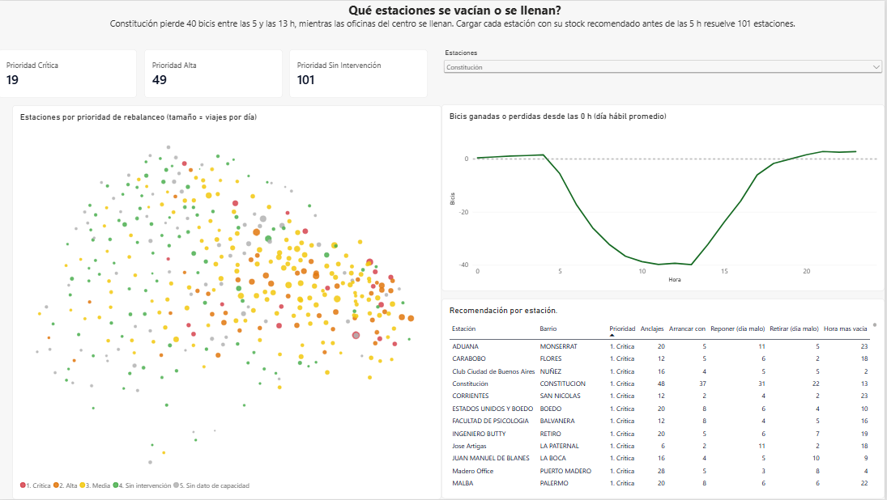
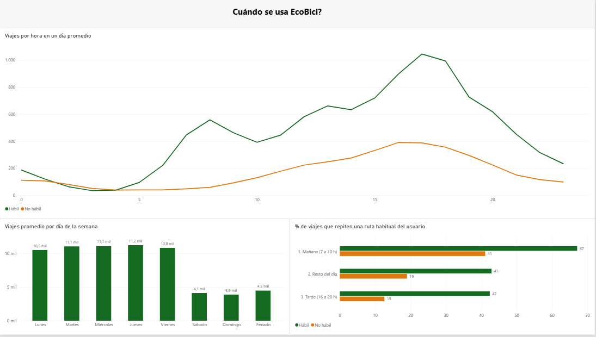
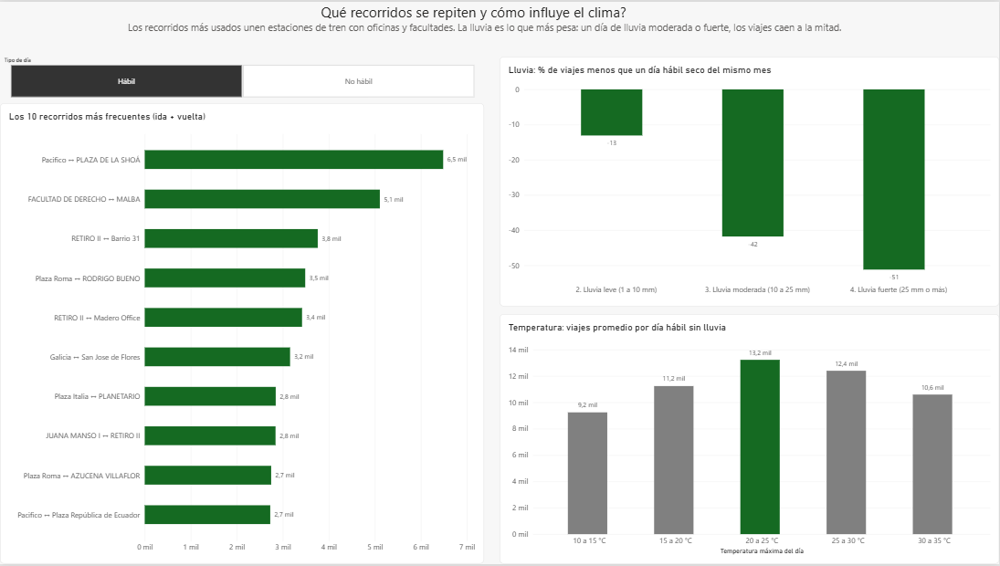
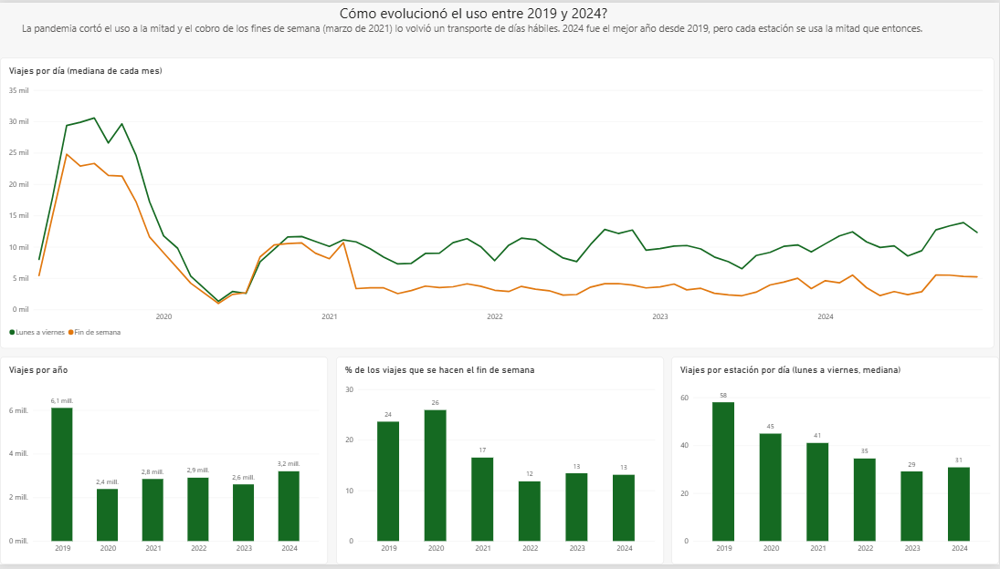

# EcoBici CABA

Análisis de los viajes del sistema de bicicletas públicas de la Ciudad de Buenos Aires con **SQL (DuckDB)** y **Power BI**: cuándo y para qué se usa, qué recorridos son los más frecuentes y, sobre todo, **qué estaciones se vacían o se llenan y qué hacer al respecto** (el problema de rebalanceo).



## Preguntas

1. **¿Cuándo se usa?** Horas y días pico. ¿Se usa más para ir a trabajar o para pasear?
2. **¿Qué estaciones se vacían o se llenan?** Flujo neto de bicis por estación y franja horaria, en relación con su capacidad. Recomendación de rebalanceo: qué estaciones, en qué horario y cuántas bicis mover.
3. **¿Cuáles son los recorridos más frecuentes?**
4. **¿Cómo influye el clima?** Lluvia y temperatura contra la cantidad de viajes.
5. **¿Cómo evolucionó el uso entre años?**

## Dashboard

El dashboard de Power BI ([`dashboard/ecobici.pbix`](dashboard/ecobici.pbix)) tiene una página por pregunta.

**1. Uso:** viajes por hora y por día de la semana, y cuántos viajes repiten una ruta habitual.



**2. Rebalanceo:** mapa de estaciones por prioridad, curva del día de la estación elegida y recomendación para cada estación (con cuántas bicis arrancar y cuántas mover en un día malo).


**3. Recorridos y clima:** los 10 recorridos más frecuentes en días hábiles y no hábiles, y el efecto de la lluvia y la temperatura.



**4. Evolución:** viajes por día mes a mes desde 2019, y la comparación entre años.



El dashboard no lee la base directamente: [`src/exportar_powerbi.py`](src/exportar_powerbi.py) exporta a Parquet tablas chicas y ya agregadas, una por gráfico. Así, el archivo pesa menos de 300 KB, aunque el análisis se hizo sobre millones de viajes.

## Resultados

### 1. ¿Cuándo se usa? ¿Para ir a trabajar o para pasear?

**EcoBici es principalmente un medio de transporte, no de paseo.** El 85% de los viajes se hace en días hábiles: un día hábil promedio tiene unos 10.900 viajes, contra unos 4.000 en un sábado, un domingo o un feriado.

| | Días hábiles | Fines de semana y feriados |
|---|---:|---:|
| Viajes de una ruta habitual del usuario | **46%** | 18% |
| Viajes circulares (vuelven a la misma estación) | 6% | **13%** |
| Duración mediana | 15 min | **25 min** |
| Viajes de más de 30 minutos | 14% | **41%** |

- **Los días hábiles tienen dos picos:** a las 8 h (560 viajes por hora) y a las 17 h (1.045 viajes por hora). Los fines de semana no hay pico a la mañana: el uso crece de a poco y se mantiene alto de 14 a 19 h.
- **El pico de la tarde casi duplica al de la mañana.** La franja de 16 a 20 h concentra el 34% de los viajes de un día hábil, y la de 7 a 10 h, el 13%. Pero a la mañana el uso es más "de trabajo": el 67% de esos viajes son de una ruta habitual, contra el 42% a la tarde. A la tarde se mezcla la vuelta a casa con trámites y salidas.

Consultas: [`sql/10_uso_temporal.sql`](sql/10_uso_temporal.sql).

### 2. ¿Qué estaciones se vacían o se llenan? ¿Qué hacer?

**El desbalance se da dentro del día, no de un día para otro.** A la mañana, la gente llega en tren a Constitución y a Retiro, toma una bici y la deja en las zonas de oficinas. A la tarde hace el viaje inverso.

- **Constitución pierde en promedio 40 bicis entre las 5 y las 13 h**, el 83% de sus 48 anclajes, y las recupera entre las 14 y las 19 h.
- **Las oficinas del centro se llenan:** Madero Office gana 18 bicis hasta las 11 h, Juana Manso 16 y Macacha Güemes 12.

Para cada estación se buscó **con cuántas bicis conviene arrancar el día** para no quedarse vacía ni llena, y **cuántas hay que mover en un día malo** (percentil 90).

| Prioridad | Estaciones | % de los movimientos | Criterio |
|---|---:|---:|---|
| Crítica | 19 | 8% | El mejor stock inicial alcanza en menos de la mitad de los días hábiles |
| Alta | 49 | 19% | Alcanza entre el 50% y el 70% de los días |
| Media | 152 | 45% | Alcanza entre el 70% y el 90% de los días |
| Sin intervención | 101 | 15% | Alcanza en el 90% de los días o más |
| Sin dato de capacidad | 74 | 13% | No se pudo cruzar con el archivo de capacidad |

**Recomendaciones:**

1. **Antes de las 5 h, cargar cada estación con su stock recomendado** y no llenarlas todas. Por ejemplo, Constitución con 37 de sus 48 anclajes, Retiro II con 29 de 40 y Madero Office con solo 5 de 28, porque a la mañana se llena. Con ese ajuste solo, 101 estaciones no necesitan más intervención en 9 de cada 10 días.
2. **A media mañana (de 10 a 12 h), una ruta que lleve bicis de las oficinas a Constitución.** Las estaciones de Puerto Madero, Monserrat y San Nicolás llegan a su pico entre las 9 y las 13 h, que es justo cuando Constitución toca su mínimo (13 h). El mismo camión resuelve los dos problemas en un viaje.
3. **Ampliar Constitución.** Es la estación más usada (256 movimientos por día hábil) y, aun con el mejor stock inicial, en un día malo hay que reponerle 31 bicis y retirarle 22. Ningún otro caso se acerca.
4. **Estaciones chicas con mucha demanda:** Planetario (7 anclajes), José Artigas (6) y Teatro Picadero (8) quedan críticas porque tienen muy pocos anclajes para la demanda que reciben. Sumar anclajes ahí es más barato que rebalancearlas todos los días.

Consultas: [`sql/20_rebalanceo.sql`](sql/20_rebalanceo.sql). La tabla `rebalanceo` tiene la recomendación para cada una de las 395 estaciones.

### 3. ¿Cuáles son los recorridos más frecuentes?

**La demanda está muy repartida.** Hay 51 mil pares de estaciones distintos con al menos un viaje. Los 10 recorridos más usados suman el 1,4% de los viajes, los 100 más usados el 6,8% y los 1.000 más usados el 28%.

**Los recorridos más usados en días hábiles son de "última milla":** conectan una estación de tren o de subte con oficinas, facultades o barrios cercanos.

| # | Recorrido (ida + vuelta) | Viajes en días hábiles | Distancia |
|---:|---|---:|---:|
| 1 | Pacífico ↔ Plaza de la Shoá | 6.484 | 770 m |
| 2 | Facultad de Derecho ↔ MALBA | 5.108 | 1,4 km |
| 3 | Retiro II ↔ Barrio 31 | 3.759 | 1,1 km |
| 4 | Plaza Roma ↔ Rodrigo Bueno | 3.487 | 2,1 km |
| 5 | Retiro II ↔ Madero Office | 3.418 | 1,2 km |

- **Se usan en los dos sentidos:** en los 20 recorridos más frecuentes, cada sentido tiene entre el 40% y el 60% de los viajes. Son la ida y la vuelta de un mismo trayecto habitual.
- **Los fines de semana, el uso se muda a los parques de Palermo:** Plaza Italia, el Rosedal (Plazoleta Río de la Plata) y Plaza de la Shoá, con viajes de unos 30 minutos.
- **Son viajes cortos:** la mitad recorre menos de 1,9 km en línea recta. En el 22% de los viajes, el origen y el destino quedan en el mismo barrio.

Consultas: [`sql/30_recorridos.sql`](sql/30_recorridos.sql). La tabla `recorridos` tiene los 89 mil pares origen-destino, con coordenadas para dibujarlos en un mapa.

### 4. ¿Cómo influyen la lluvia y la temperatura?

**La lluvia es el factor que más pesa.** Cada día hábil lluvioso se comparó con los días hábiles secos de su mismo mes, para no confundir la lluvia con la estación del año:

| Lluvia en el día | Días hábiles | Viajes frente a un día seco del mismo mes |
|---|---:|---:|
| Leve (1 a 10 mm) | 34 | −13% |
| Moderada (10 a 25 mm) | 15 | **−42%** |
| Fuerte (25 mm o más) | 8 | **−51%** |

- **Hora por hora, el efecto es más fuerte todavía:** en una hora en que llueve 1 mm o más, los viajes caen un 63% frente a la misma hora de un día seco del mismo mes. Con llovizna (menos de 1 mm) caen un 17%.
- **La temperatura ideal está entre 20 y 25 °C de máxima.** En días hábiles secos, el promedio es de 13.200 viajes con 20 a 25 °C, de 9.200 con 10 a 15 °C y de 10.600 con 30 a 35 °C. Este efecto está menos aislado que el de la lluvia, porque los días fríos coinciden con las vacaciones de invierno.

**Para la operación:** el pronóstico de lluvia sirve para planificar. Un día de lluvia moderada o fuerte, la demanda cae a la mitad, así que los camiones de rebalanceo pueden dedicarse a mantenimiento.

Consultas: [`sql/40_clima.sql`](sql/40_clima.sql).

### 5. ¿Cómo evolucionó el uso entre años?

| Año | Viajes | Usuarios | Estaciones activas por día | Viajes por día de lunes a viernes (mediana) | Viajes por día de fin de semana (mediana) | % de viajes en fin de semana |
|---|---:|---:|---:|---:|---:|---:|
| 2019* | 6.099.449 | 416.125 | 392 | 22.726 | 17.857 | 24% |
| 2020 | 2.384.416 | 241.752 | 199 | 8.932 | 7.370 | 26% |
| 2021 | 2.843.844 | 180.885 | 230 | 9.436 | 3.733 | 17% |
| 2022 | 2.902.583 | 203.053 | 296 | 10.198 | 3.249 | 12% |
| 2023 | 2.596.761 | 210.112 | 315 | 9.166 | 3.261 | 13% |
| 2024 | 3.196.528 | 256.246 | 352 | 10.842 | 4.295 | 13% |

<sub>* 2019 empieza el 17 de febrero, cuando arrancó el sistema actual, y la red recién estuvo completa en junio.</sub>

Se ven tres quiebres:

1. **La pandemia (2020).** No hay viajes en abril de 2020, y en mayo hubo apenas 1.300 por día hábil. La red pasó de unas 395 estaciones a menos de 200 y tardó cuatro años en volver a ese tamaño (386 en diciembre de 2024).
2. **El cobro de los fines de semana (marzo de 2021).** De febrero a marzo de 2021, los viajes de fin de semana cayeron de unos 10.700 por día a 3.300, mientras que los de lunes a viernes no cambiaron. Coincide con el inicio del cobro a los residentes los sábados, domingos y feriados ([Ámbito, 14/03/2021](https://www.ambito.com/viajes/el-sistema-ecobici-porteno-dejo-ser-gratis-cuales-son-los-precios-usar-las-bicicletas-n5176631)). Desde entonces, EcoBici es sobre todo un transporte de días hábiles: el fin de semana pasó del 24% de los viajes al 13%.
3. **La recuperación de 2024.** Fue el mejor año desde 2019: 23% más viajes y 22% más usuarios que en 2023. Entre septiembre y noviembre de 2024 se alcanzaron los valores más altos de la serie después de 2019: unos 13.300 viajes por día de lunes a viernes (mediana).

**Igual, el uso está lejos de 2019.** Entre junio y octubre de 2019, con la red completa, se hacían unos 29.500 viajes por día de lunes a viernes, 2,2 veces más que en el mejor momento de 2024. Y como la red ya recuperó casi todas sus estaciones, la diferencia no se explica por tener menos estaciones: **cada estación se usa la mitad** (58 viajes por estación y por día en 2019, contra 31 en 2024).

Consultas: [`sql/50_evolucion.sql`](sql/50_evolucion.sql).

## Datos

- **Viajes:** [Bicicletas públicas](https://data.buenosaires.gob.ar/dataset/bicicletas-publicas), portal de datos abiertos del GCBA. Un archivo por año (2010 a 2026) con estación de origen y destino, fecha y hora de salida y llegada.
- **Estaciones:** [Estaciones de bicicletas públicas](https://data.buenosaires.gob.ar/dataset/estaciones-bicicletas-publicas), con coordenadas y capacidad.
- **Usuarios:** edad, género y fecha de alta, en el mismo dataset de los viajes.
- **Clima:** temperatura y lluvia diarias y horarias de Buenos Aires, de la [API histórica de Open-Meteo](https://open-meteo.com/en/docs/historical-weather-api) (reanálisis ERA5, licencia CC BY 4.0) (`python -m src.clima 2024`).
- **Feriados:** feriados nacionales de [ArgentinaDatos](https://argentinadatos.com) (`python -m src.feriados 2024`).

## Metodología

- **Día hábil vs no hábil:** los feriados cuentan como no hábiles, igual que los fines de semana. Un feriado que cae un miércoles se comporta como un domingo (unos 4.500 viajes contra 11.000).
- **Promedios por día calendario:** los viajes promedio por hora se dividen por la cantidad de días de cada tipo, no por los días con viajes.
- **Señales de viaje "de trabajo":**
  - *Ruta habitual:* el usuario hace ese mismo recorrido, en cualquier sentido, en 5 días distintos o más del año.
  - *Ida y vuelta:* el usuario va de A a B y su siguiente viaje del día es de B a A. Es una señal más estricta, porque no detecta a quien va en bici y vuelve en otro medio. En días hábiles llega al 15% de los viajes.
- **Rebalanceo:**
  - Cada viaje es una salida (−1) en su estación de origen y una llegada (+1) en la de destino. Para cada estación y día hábil se acumula el saldo viaje a viaje, y así se obtiene la mayor pérdida y la mayor ganancia de ese día.
  - Una estación que arranca con *S* bicis "aguanta" un día si *S* ≥ la mayor pérdida del día y si *S* + la mayor ganancia del día ≤ capacidad. Se prueban todos los *S* posibles, de 0 a la capacidad, y se elige el que aguanta más días.
  - Se trabaja con días reales y no con el día promedio, porque el promedio esconde los días malos. Por la misma razón, lo que hay que mover se informa con el percentil 90.
- **Comparación entre años:**
  - Los archivos de 2019 a 2023 tienen otro formato: ids con texto ("5BAEcobici") y duración con coma de miles ("2,814"). La duración se validó contra la diferencia entre la hora de llegada y la de salida, y coincide en el 100% de los viajes.
  - El portal ya les había sacado los viajes de menos de 1 minuto a esos años, pero no a 2024. Para comparar parejo, a todos los años se les aplicaron los mismos filtros.
  - Se compara lunes a viernes contra fin de semana, sin separar los feriados, porque no hay calendario de feriados disponible para 2019 y 2020. Por eso se usa la mediana de viajes por día, que casi no se mueve por los pocos feriados de cada año.
  - Los años anteriores no se guardan viaje por viaje en la base: se leen de los CSV y se agregan por día.
- **Capacidad de las estaciones:** el GeoJSON de estaciones trae la capacidad (`ANCLAJES`), pero su id no coincide con el de los viajes y reutiliza números de estación. Por eso el cruce se hace por número de estación y se valida con el nombre (similitud ≥ 0,85) o con la distancia (menos de 300 m). Así queda bien asignada la capacidad de estaciones que concentran el 91% de los viajes. Las demás quedan sin dato en lugar de quedar con una capacidad que no es la suya.

## Limitaciones

- **Los viajes no incluyen los movimientos de los camiones de rebalanceo**, así que no se sabe cuántas bicis había realmente en cada estación. El análisis mide la demanda de los usuarios, no el estado de las estaciones.
- **Demanda censurada:** cuando una estación está vacía, nadie puede sacar una bici, y ese viaje no queda registrado. Por eso, en las estaciones que se vacían seguido, la demanda real es mayor que la medida.
- **Capacidad:** el archivo de capacidad es posterior a 2024 y no tiene fecha de actualización, así que puede no reflejar la capacidad de cada estación durante todo el año. 74 estaciones, con el 13% de los movimientos, quedan sin dato.
- **Usuarios:** el archivo de usuarios del portal solo incluye a quienes se registraron en 2024 (el 32% de los viajes), así que no se analiza la edad.

## Estructura del proyecto

```
├── data/
│   ├── raw/          # archivos originales del portal (no incluidos en el repo)
│   ├── processed/    # base DuckDB y Parquet para Power BI (se generan con src/)
│   └── external/     # clima
├── sql/              # consultas de limpieza, modelo y análisis, numeradas en orden
├── src/              # scripts de Python para descargar y cargar los datos
├── dashboard/        # archivo de Power BI
└── reports/figures/  # capturas para el README
```

## Cómo reproducirlo

Requiere Python 3.12 o superior.

```bash
git clone https://github.com/magaliorellana01/eco-bici-caba.git
cd eco-bici-caba
python -m venv .venv
.venv\Scripts\activate          # Windows  (Linux/Mac: source .venv/bin/activate)
pip install -r requirements.txt
```

1. Descargar estos archivos del portal y guardarlos en `data/raw/`:
   - [Recorridos realizados 2024](https://data.buenosaires.gob.ar/dataset/bicicletas-publicas): descomprimir el ZIP (`badata_ecobici_recorridos_realizados_2024.csv`).
   - Para la evolución entre años, los recorridos de 2019 a 2023, del mismo dataset: descomprimir cada ZIP (`trips_2019.csv` a `trips_2023.csv`). Son opcionales: sin ellos, la carga funciona igual, pero sin la pregunta 5.
   - [Estaciones (SHP) (nuevo sistema)](https://data.buenosaires.gob.ar/dataset/estaciones-bicicletas-publicas): descomprimir el ZIP (`nuevas-estaciones-ecobici.shp` y sus archivos asociados).
   - [Estaciones (GEOJSON) (nuevo sistema)](https://data.buenosaires.gob.ar/dataset/estaciones-bicicletas-publicas/resource/e62fb076-dc64-4c42-b8ea-a8dd47395062): guardar como `estaciones.geojson`. Si el navegador lo abre como texto, usar Ctrl + S.
2. Generar la base: `python -m src.cargar`. Tarda alrededor de un minuto con todos los años y crea `data/processed/ecobici.duckdb`. Los feriados y el clima ya están en `data/external/`.
3. Exportar las tablas para el dashboard: `python -m src.exportar_powerbi`. Crea los archivos `.parquet` en `data/processed/powerbi/`.
4. Abrir `dashboard/ecobici.pbix` con Power BI Desktop. El archivo apunta a los Parquet con la ruta de la computadora donde se armó, así que hay que cambiarla en *Transformar datos > Configuración de origen de datos > Cambiar origen* y después hacer clic en *Actualizar*.

## Tecnologías

SQL · DuckDB · Python · Power BI
